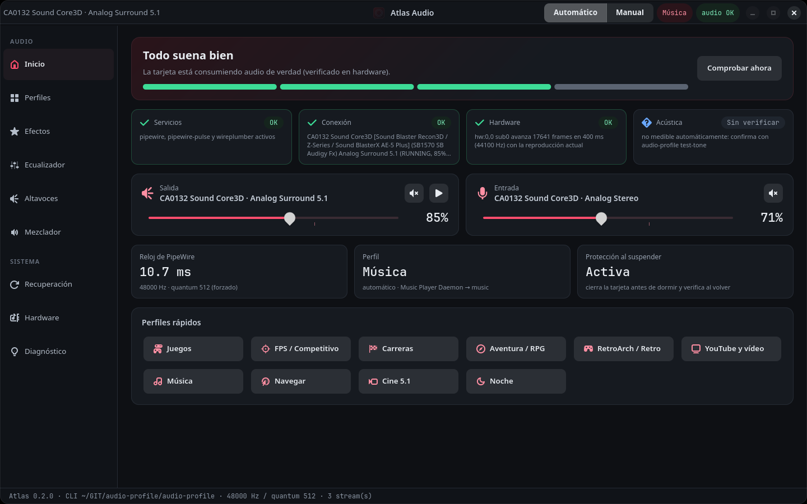
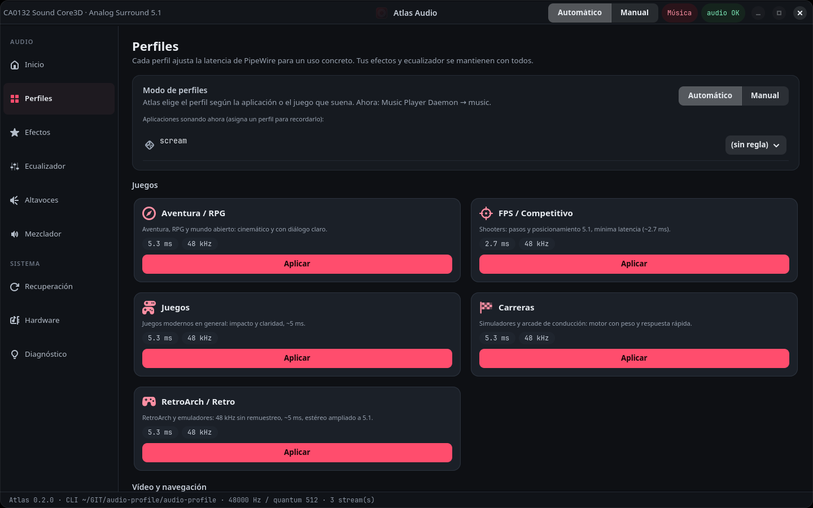
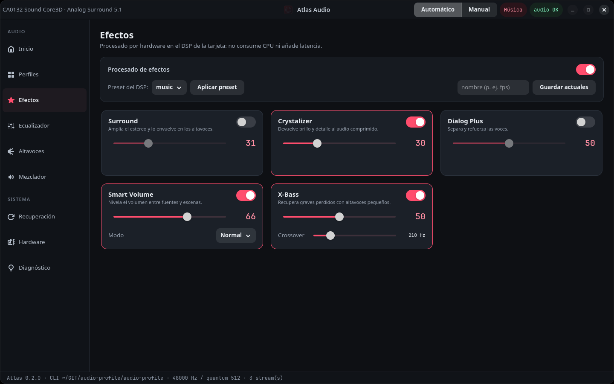
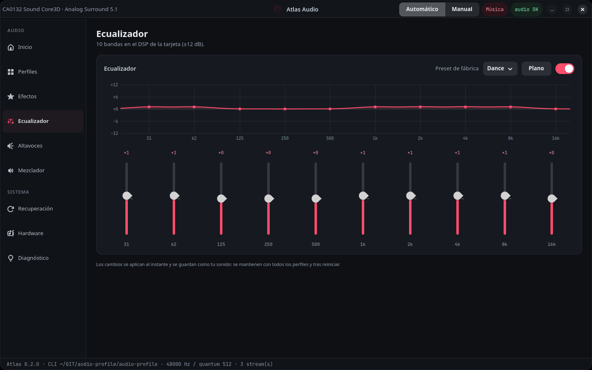
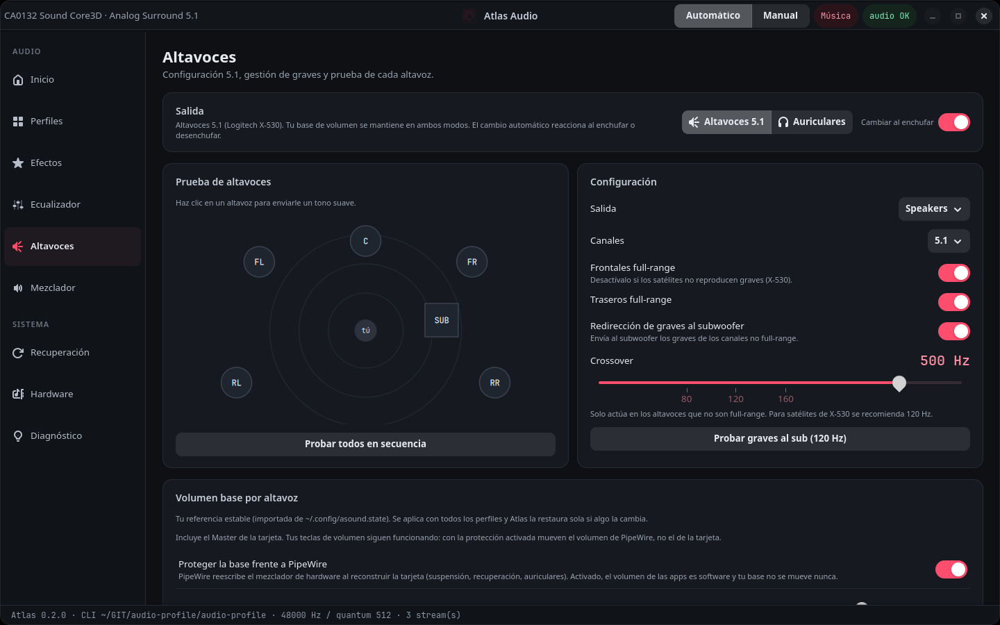
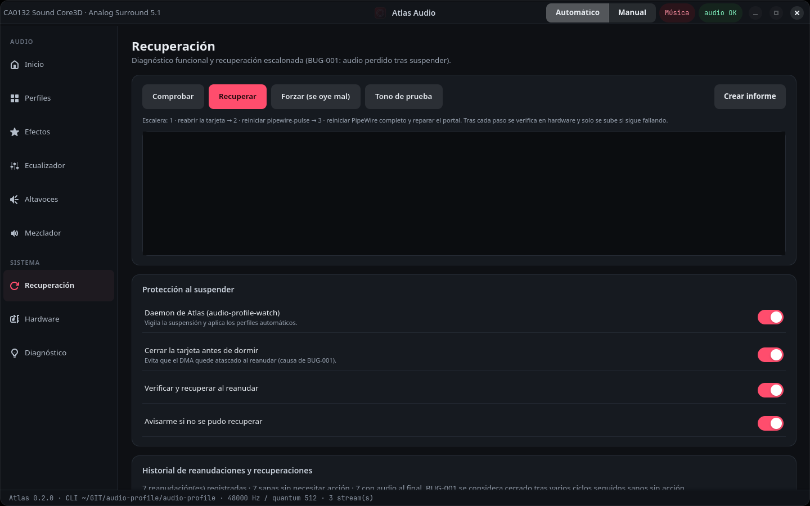
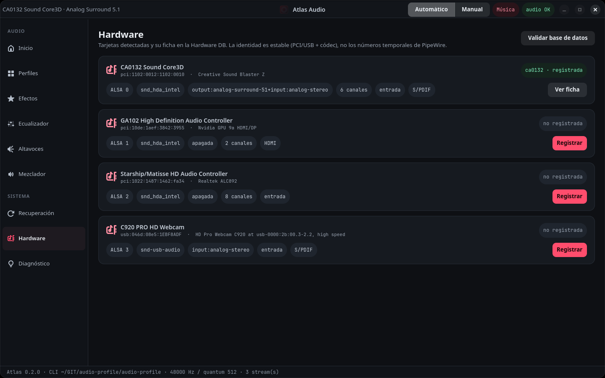
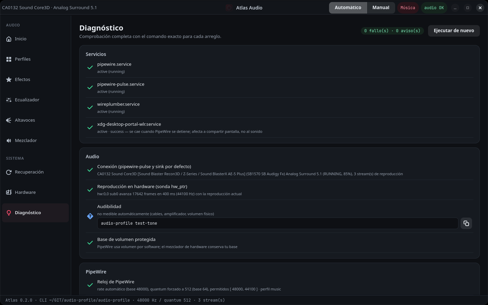

# Project Atlas · audio-profile 0.2

Administración de audio para Linux sobre PipeWire, WirePlumber y ALSA, en dos formas de
trabajar:

- **`audio-profile`**: CLI en C. Diagnóstico, recuperación, perfiles, DSP y Hardware DB.
  Todos los comandos aceptan `--json`.
- **Atlas Audio** (`atlas-audio`): interfaz GTK4 + libadwaita (Wayland) que usa la CLI.

Hardware de referencia: Sound Blaster Z (CA0132) + Logitech X-530 5.1.



<details>
<summary><b>Más capturas</b></summary>

| | |
|---|---|
|  |  |
| **Perfiles**: modo automático o manual y perfiles por uso | **Efectos** del DSP de la tarjeta |
|  |  |
| **Ecualizador** de 10 bandas | **Altavoces**: prueba por canal, graves y audio base |
|  |  |
| **Recuperación** y protección al suspender | **Hardware**: tarjetas reconocidas por identidad estable |
|  | |
| **Diagnóstico** con el comando exacto para cada arreglo | |

</details>

## Instalar

```bash
git clone https://github.com/1985a/project-atlas.git
cd project-atlas
make && make test
make install                         # en ~/.local (sin root, nada en /)
systemctl --user enable --now audio-profile-watch.service
```

Instalación de sistema: `sudo make install PREFIX=/usr`.
Dependencias: `pipewire`, `wireplumber`, `json-glib`, `glib2`, `alsa-lib`, `alsa-utils`,
`python-gobject`, `gtk4`, `libadwaita`.

## Lo esencial

```bash
audio-profile status [--probe]   # servicios · conexión · hardware · acústica
audio-profile doctor             # diagnóstico completo con comando de arreglo
audio-profile recover            # escalera verificada (ver docs/BUG-001.md)
audio-profile test-tone          # ¿se oye?
audio-profile history            # cada reanudación/recuperación registrada
```

Flujo ante "no se oye": `status` → `recover` → `test-tone`.

## Perfiles

| Perfil | Uso | Latencia | DSP |
|---|---|---|---|
| `fps` | shooters | 2.7 ms | pasos 2–4 kHz, graves contenidos, Smart Volume |
| `racing` | carreras | 5.3 ms | X-Bass fuerte, 31–125 Hz arriba |
| `adventure` | aventura / RPG | 5.3 ms | cinemático, Dialog Plus |
| `gaming` | juegos en general | 5.3 ms | equilibrado |
| `retro` | RetroArch / emuladores | 5.3 ms a 48 kHz | Surround (estéreo → 5.1), Crystalizer |
| `video` | YouTube / Twitch | auto | Dialog Plus, Smart Volume, Surround |
| `cinema` | películas 5.1 | 10.7 ms | mezcla nativa + diálogo |
| `music` | música | 10.7 ms, rate nativo | sin compresión, loudness suave |
| `browsing` | navegar | 21 ms | voces claras, volumen parejo |
| `voice` · `streaming` · `night` · `reference` | llamadas · OBS · noche · sin efectos | | |

```bash
audio-profile list | show <p> | apply <p> | reset
```

### Base de volumen (tu `asound.state`)

Tu archivo de alsactl es la base de **todos** los perfiles. Al aplicar un perfil se
aplican tres capas en orden:

1. `base`: configuración de altavoces (salida, 5.1, full-range, redirección de graves).
2. `volumes`: volumen y switch de cada canal, más los ajustes de captura.
3. `<perfil>`: solo efectos y ecualizador.

```bash
audio-profile base import          # lee ~/.config/asound.state (una vez, o al cambiarlo)
audio-profile base save            # tus volúmenes y altavoces actuales pasan a ser la base
audio-profile base show | apply
```

La importación también crea el perfil **«Mi sonido»** (`personal`) con tus efectos de
siempre.

**Protección de la base** (`audio-profile base hw-lock on`). Por defecto PipeWire usa el
mezclador de hardware como volumen del sink y lo reescribe al reconstruir la tarjeta
(suspensión, recuperación, auriculares). Comprobado: Master pasaba de 80 a 95, Front de 95 a 87
y PCM de 237 a 252. El bloqueo activa `api.alsa.soft-mixer` solo para esa tarjeta: el volumen
de las apps pasa a ser software y el hardware conserva tu base siempre. El daemon aplica la base y el perfil actual al iniciar sesión, así que ya no hace
falta `alsactl --file ~/.config/asound.state restore`.
`audio-profile dsp apply x530-graves-al-sub` prueba la gestión de graves recomendada
(satélites no full-range, 120 Hz); `base save` la adopta. El crossover del driver CA0132
va en pasos de 10 Hz (tabla `float_xbass_xover_lookup`).

Los presets están en `hardware/<id>/dsp/<perfil>.conf`; los tuyos, que tienen prioridad, en
`~/.config/audio-profile/hardware/<id>/dsp/`.
Para personalizar un perfil, ajusta los efectos en la GUI y guárdalos con el mismo nombre
(`audio-profile dsp save fps`). Tu versión tiene prioridad.

### Automáticos

El daemon `watch` elige el perfil según lo que suena:
- **ejecutable** del programa;
- **MPRIS**: título y URL de lo que reproduce el navegador, aunque la pestaña esté en
  segundo plano (`title~`, `url~`);
- **juego de Steam**: por ID conocido o por **género automático** (`genre=racing|fps|adventure`).
  El género se calcula con las etiquetas votadas de SteamSpy, o de la tienda de Steam si
  SteamSpy no tiene datos; se guarda en caché y solo se envía el número del juego.
  Ver o forzar: `audio-profile steam-genre <appid>`. Desactivar: `auto.steam_lookup=no`.

### Auriculares

```bash
audio-profile output [status|speakers|headphones|toggle]
```

En modo auriculares:
- la tarjeta pasa a `Output Select=Headphone`;
- PipeWire usa estéreo, para que el 5.1 se mezcle bien;
- cada perfil usa su variante `<perfil>.hp` (surround virtual y la mitad de X-Bass);
- tu base de volumen se mantiene.

Con `output.follow_jack=yes` el modo cambia solo al enchufar o desenchufar. Reacciona a los
cambios del jack, porque el de la Sound Blaster Z puede marcar "on" siempre. En sway es la
tecla `h` del modo Audio. Las reglas están en
`rules/auto.rules`; las tuyas, que se leen antes, van en `~/.config/audio-profile/auto.rules`.

```bash
audio-profile auto status          # qué suena y qué perfil le toca
audio-profile auto assign racing steam=244210
audio-profile auto on|off          # aplicar a mano pausa el modo automático
```

## Hardware DB

```bash
audio-profile devices              # identidad estable + coincidencia en la DB
audio-profile hardware-info ca0132
audio-profile hardware-register 3  # registra sin duplicar (en ~/.config)
audio-profile hardware-validate
```

Los resultados de coincidencia son: única, ninguna, ambigua (dos entradas) o parcial (mismo
chip, otro modelo: `--link` o `--new`). Nunca se usan IDs de PipeWire como clave, y los
archivos versionados no se modifican.

## Plugins fuera de `/`

```bash
scripts/plugins-external.sh [--dir /mnt/disco16t/plugins_audio] [paquete ...]
```

Descarga los paquetes de plugins de Arch sin root, verifica el SHA-256 contra la base de
datos de pacman, extrae solo los plugins y declara `LV2_PATH`, `LADSPA_PATH`, etc. en
`~/.config/environment.d`.

## Archivos

| Ruta | Contenido |
|---|---|
| `~/.config/audio-profile/atlas.conf` | opciones (`watch.*`, `recover.*`, `probe.*`) |
| `~/.config/audio-profile/{profiles,hardware,presets,snapshots}` | datos del usuario |
| `~/.local/state/audio-profile/` | historial, informes, copias ALSA, estado |

## Para desarrolladores

- [docs/ARQUITECTURA.md](docs/ARQUITECTURA.md): qué hace cada módulo y cómo se conectan.
- [docs/DESARROLLO.md](docs/DESARROLLO.md): compilar, `make test` / `make test-asan` / `make lint` y las reglas del código.

Más: [docs/BUG-001.md](docs/BUG-001.md), [CHANGELOG.md](CHANGELOG.md).

## Licencia

Copyright (C) 2026 Wagner

Este programa es software libre: puedes redistribuirlo y modificarlo bajo los términos de
la **GNU General Public License versión 3** o (a tu elección) cualquier versión posterior,
publicada por la Free Software Foundation. Se distribuye con la esperanza de que sea útil,
pero **sin ninguna garantía**. Texto completo en [LICENSE](LICENSE).

`SPDX-License-Identifier: GPL-3.0-or-later`
